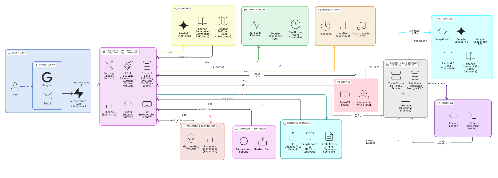

<div align="center">

# 🎓 SYLEDUTECH - AI-Powered Learning Revolution

### *Built by SYLESH PAVENDAN*

[](https://reactjs.org/)
[](https://www.typescriptlang.org/)
[](https://vitejs.dev/)
[](https://threejs.org/)

[](https://supabase.com/)
[](https://deepmind.google/technologies/gemini/)
[](https://framevr.io)

---

### 🚀 Next-Generation Learning Platform with Immersive 3D Experiences

*A sophisticated full-stack application combining AI tutoring, collaborative learning, and cutting-edge visual design with eye-friendly color systems optimized for long study sessions.*

[🌟 Live Demo](#) | [📖 Documentation](#-installation--setup) | [🐛 Report Bug](https://github.com/SYLESH-1125/EDUMITE/issues) | [💡 Request Feature](https://github.com/SYLESH-1125/EDUMITE/issues)

</div>

---

## **Table of Contents**
1. [Overview](#-overview)
2. [Key Features](#-key-features)
3. [Architecture](#️-architecture)
4. [Tech Stack](#️-tech-stack)
5. [Prerequisites](#-prerequisites)
6. [Installation & Setup](#-installation--setup)
7. [Visual Design System](#-visual-design-system)
8. [Project Structure](#-project-structure)
9. [Routes](#️-routes)
10. [Security](#-security)
11. [Development](#️-development)
12. [Deployment](#-deployment)
13. [Roadmap](#️-roadmap)
14. [Creator](#-creator)
15. [License & Support](#-license--support)

---

## 🎯 **Overview**

**EDUMITE** is a revolutionary AI-powered learning platform that transforms education through:

- 🤖 **Gemini AI Integration** - Intelligent tutoring, roadmap generation, and course creation
- 🎮 **Gamified Learning** - XP system, streaks, leaderboards, and achievement tracking
- 🎨 **3D Visual Experiences** - WebGL-powered GridScan, LaserFlow, SpotlightCard effects
- 🎭 **Virtual Study Rooms** - FrameVR integration for collaborative learning
- 🎯 **Smart Planning** - AI-driven study schedules with Google Classroom sync
- 🎨 **Eye-Friendly Design** - Soft gold/pink color palette optimized for 6-10 hour sessions
- 🌍 **Global Accessibility** - 30+ languages, dyslexia fonts, colorblind themes

### 💡 **Why EDUMITE?**

Built by **SYLESH PAVENDAN**, this platform addresses the core challenges of modern education:
- ✅ Personalized AI tutoring available 24/7
- ✅ Immersive 3D environments that enhance focus
- ✅ Collaborative virtual study spaces
- ✅ Automated scheduling and progress tracking
- ✅ Accessible design for all learners
- ✅ Production-ready with comprehensive security

---

## ✨ **Key Features**

### 🎯 **Core Capabilities**

#### 🤖 **AI-Powered Learning**
- **Gemini AI Tutor** - Context-aware explanations and personalized guidance
- **Smart Roadmap Generator** - Skill-based learning paths with milestone tracking
- **Course Generator** - Automated syllabus creation with structured modules
- **AI Study Planner** - Deadline-aware scheduling with priority optimization

#### 🎨 **Immersive 3D Experiences**
- **GridScan** - WebGL perspective grid with bloom effects (Dashboard)
- **LaserFlow** - Volumetric fog shaders (Focus Room, Study VR)
- **GridDistortion** - Interactive ripple effects (Roadmap, Notes)
- **SpotlightCard** - Mouse-following highlight effects (AI Bot)
- **FlowingMenu** - GSAP-powered marquee animations (Dashboard)

#### 🎯 **Productivity Tools**
- **Focus Room** - Pomodoro timers with ambient audio (rain, forest, cafe, ocean)
- **Monaco IDE** - Browser-based code editor with Judge0 execution
- **Notes Workspace** - Rich editor with PDF uploads and AI summaries
- **Study Planner** - Google Classroom sync with auto-generated schedules
- **Analytics Dashboard** - Real-time progress tracking with Recharts visualizations

#### 🌐 **Collaboration Features**
- **Study VR** - FrameVR virtual spaces with voice/video chat
- **Discussion Forums** - Threaded conversations per course
- **Study Groups** - Team collaboration with shared resources
- **Mentor Chat** - AI-powered mentorship and guidance
- **Leaderboards** - Gamified rankings and achievements

#### 🎨 **Design System**
- **Soft Color Palette** - Eye-friendly Gold (#C9B458), Pink (#C27BA0), Blue (#6DAEDB)
- **WCAG AA Compliant** - 12.8:1 primary text contrast ratio
- **Translucent Shadows** - Reduced visual weight for comfort
- **Accessibility First** - Dyslexia fonts, colorblind themes, screen reader support

---

## 🏗️ **Architecture**

<picture><source srcset=".gitbook/assets/edura-architecture.png" media="(prefers-color-scheme: dark)"></picture>

### 🛠️ **Tech Stack**

#### **Frontend**
```
⚛️  React 18           - UI framework with hooks and concurrent features
📘  TypeScript 5        - Type-safe development
⚡  Vite 7             - Lightning-fast build tool and dev server
🎨  Tailwind CSS       - Utility-first styling with custom palette
🎭  Framer Motion      - Advanced animations and gestures
🎬  GSAP               - Professional animation engine
```

#### **3D Graphics & Visualization**
```
🎮  Three.js           - WebGL 3D rendering engine
🌟  @react-three/fiber - React renderer for Three.js
✨  Postprocessing     - Bloom, chromatic aberration effects
🔮  Custom Shaders     - GLSL volumetric fog, ripple effects
```

#### **UI Components**
```
🧩  shadcn/ui          - Radix UI primitives with Tailwind
🎯  Radix UI           - Accessible component primitives
📊  Recharts           - Composable charting library
🖥️  Monaco Editor      - VS Code's editor in the browser
```

#### **State & Data**
```
🐻  Zustand            - Lightweight state management
🔄  TanStack Query     - Server state synchronization
📋  React Hook Form    - Performant form handling
✅  Zod                - TypeScript-first schema validation
```

#### **Backend & Database**
```
🗄️  Supabase           - PostgreSQL database + Auth + Storage
🔐  Row Level Security - Database-level access control
🚀  Supabase Storage   - File uploads for notes/audio/PDFs
🔑  OAuth Integration  - Google Classroom sync
```

#### **AI & APIs**
```
🤖  Google Gemini AI   - Chat, summaries, roadmaps, quizzes
⚖️  Judge0 API         - Code execution sandbox (50+ languages)
🌍  RapidAPI Translate - 30+ language support
📚  Udemy/Coursera API - External course discovery
```

#### **Backend Server**
```
🟢  Node.js + Express  - Proxy server for curated APIs
🔒  CORS Security      - Protected endpoints
📡  RESTful Routes     - External course fetching
```

---

## 🎨 **Visual Design System**

### **Color Palette** (Optimized for 6-10 Hour Study Sessions)

```css
/* Primary Colors - Dull & Eye-Friendly */
Gold:    #C9B458  /* 43% saturation - main accent */
Pink:    #C27BA0  /* 28% saturation - secondary accent */
Blue:    #6DAEDB  /* Alternate accent */

/* Backgrounds - Soft Dark Tones */
Main:    #0F1115  /* Deepblack with blue tint */
Surface: #151823  /* Card backgrounds */
Panel:   #1B1F2E  /* Elevated surfaces */

/* Text - Soft White for Comfort */
Primary: #E6E8ED  /* 92% lightness - reduced eye strain */
Muted:   #9CA3AF  /* Secondary text */

/* Utility Colors */
Success: #7FA87F  /* Soft green */
Error:   #B87C7C  /* Soft red */
Warning: #BFA36A  /* Soft amber */
Border:  #2A2E3F  /* Subtle borders */
```

### **Design Philosophy**
- ✅ **No Pure White/Black** - Prevents harsh contrast
- ✅ **Translucent Shadows** - `rgba(0,0,0,0.3)` instead of solid black
- ✅ **60% Saturation Reduction** - Compared to brutal neon theme
- ✅ **WCAG AA Compliant** - 12.8:1 primary text contrast
- ✅ **Inspired By** - Notion, Linear, Obsidian, Apple Study Mode

### **3D Visual Effects**
- **GridScan** - Perspective grid with bloom (Dashboard background)
- **LaserFlow** - Volumetric fog shader (Focus Room ambiance)
- **GridDistortion** - Interactive ripple on hover (Hero sections)
- **SpotlightCard** - Mouse-following gradient (Sidebar cards)
- **FlowingMenu** - Animated marquee hover (Navigation)

---

## 📁 **Project Structure**

```
edumite/
├── 📦 public/                    # Static assets
│   ├── 🎵 audio/                 # Ambient tracks (cafe, forest, ocean, rain)
│   └── 🤖 robots.txt
├── 🖥️ server/
│   └── index.js                  # Express proxy for external APIs
├── ⚙️ src/
│   ├── 🎯 App.tsx                # Root component with routing
│   ├── 🎨 index.css              # Global styles + CSS variables
│   ├── 🚀 main.tsx               # Vite entry point
│   │
│   ├── 🎭 components/
│   │   ├── 3D/                   # WebGL visual effects
│   │   │   ├── GridScan.tsx      # Perspective grid (Dashboard)
│   │   │   ├── LaserFlow.tsx     # Volumetric fog (Focus Room)
│   │   │   ├── GridDistortion.tsx # Ripple effect (Heroes)
│   │   │   ├── SpotlightCard.tsx # Mouse spotlight (AI Bot)
│   │   │   ├── FlowingMenu.tsx   # Marquee animation (Nav)
│   │   │   ├── ModelViewer.tsx   # 3D model loader
│   │   │   ├── Cubes.tsx         # Animated cubes (Landing)
│   │   │   └── HeroScene.tsx     # Three.js scene composer
│   │   │
│   │   ├── ui/                   # shadcn/ui primitives (40+ components)
│   │   │   ├── button.tsx, card.tsx, dialog.tsx, form.tsx...
│   │   │
│   │   ├── DockNav.tsx           # macOS-style navigation dock
│   │   ├── NavbarGold.tsx        # Top navigation bar
│   │   ├── BentoCards.tsx        # Dashboard feature cards
│   │   ├── IDE.tsx               # Monaco + Judge0 code editor
│   │   ├── MentorChat.tsx        # AI mentor interface
│   │   ├── StudyGroupChat.tsx    # Collaboration chat
│   │   ├── DiscussionForum.tsx   # Course discussions
│   │   ├── UniverseVisualization.tsx # Audio visualizer
│   │   └── ...
│   │
│   ├── 📄 pages/                 # Route components (15 pages)
│   │   ├── LandingGold.tsx       # Marketing landing page
│   │   ├── DashboardGold.tsx     # Main dashboard with GridScan
│   │   ├── AIBot.tsx             # Gemini AI tutor interface
│   │   ├── Roadmap.tsx           # Learning path generator
│   │   ├── Notes.tsx             # Note-taking workspace
│   │   ├── FocusRoom.tsx         # Pomodoro + ambient audio
│   │   ├── StudyVR.tsx           # FrameVR collaboration
│   │   ├── Courses.tsx           # Course discovery + generator
│   │   ├── CourseDetail.tsx      # Course content viewer
│   │   ├── Community.tsx         # Forums + study groups
│   │   ├── Analytics.tsx         # Progress dashboards
│   │   ├── StudyPlanner.tsx      # AI scheduling + Classroom sync
│   │   ├── Settings.tsx          # User preferences
│   │   └── Login.tsx / Register.tsx
│   │
│   ├── 🔧 services/              # API integrations
│   │   ├── authService.ts        # Supabase authentication
│   │   ├── courseService.ts      # Course CRUD operations
│   │   ├── courseGeneratorService.ts # AI course creation
│   │   ├── roadmapService.ts     # Roadmap generation
│   │   ├── notesService.ts       # Note management
│   │   ├── communityService.ts   # Forums + groups
│   │   ├── analyticsService.ts   # Progress tracking
│   │   ├── classroomService.ts   # Google Classroom OAuth
│   │   ├── translateService.ts   # RapidAPI translation
│   │   ├── userService.ts        # User profile management
│   │   └── leaderboardService.ts # Gamification
│   │
│   ├── 🪝 hooks/                 # Custom React hooks
│   │   ├── useTranslation.ts     # Multi-language support
│   │   ├── useSoundPlayer.ts     # Ambient audio player
│   │   ├── useGoogleClassroom.ts # Classroom integration
│   │   └── use-toast.ts          # Toast notifications
│   │
│   ├── 📚 lib/                   # Core utilities
│   │   ├── supabase.ts           # Supabase client config
│   │   ├── gemini.ts             # Gemini AI client
│   │   ├── auth.ts               # Auth helpers
│   │   └── utils.ts              # Utility functions
│   │
│   ├── 🗃️ store/                 # Zustand state management
│   │   ├── userStore.ts          # User session state
│   │   └── themeStore.ts         # Theme + accessibility
│   │
│   ├── 📦 types/                 # TypeScript definitions
│   │   └── classroom.ts          # Google Classroom types
│   │
│   └── 🛠️ utils/
│       └── generateSchedule.js   # AI scheduling algorithm
│
├── 📋 Configuration Files
│   ├── vite.config.ts            # Vite build configuration
│   ├── tailwind.config.ts        # Custom color palette
│   ├── tsconfig.json             # TypeScript config
│   ├── components.json           # shadcn/ui config
│   ├── eslint.config.js          # Linting rules
│   ├── postcss.config.js         # Tailwind processing
│   └── package.json              # Dependencies + scripts
│
├── 📖 Documentation
│   ├── README.md                 # This file
│   ├── SETUP.md                  # Installation guide
│   └── COLOR_REFACTOR.md         # Design system documentation
│
└── 🗄️ Database
    └── supabase-schema.sql       # PostgreSQL schema + RLS policies
```

---

## 📋 **Prerequisites**

Before installation, ensure you have:

- ✅ **Node.js** 18+ ([Download](https://nodejs.org/))
- ✅ **npm** or **bun** package manager
- ✅ **Git** ([Download](https://git-scm.com/))
- ✅ **Supabase Account** ([Sign up](https://supabase.com/))
- ✅ **Google Gemini API Key** ([Get key](https://makersuite.google.com/app/apikey))

**Optional:**
- Google Cloud Console project (for Classroom sync)
- Judge0 API key (for code execution)
- RapidAPI account (for translation)

---

## 🚀 **Installation & Setup**

### **1️⃣ Clone Repository**

```bash
git clone https://github.com/SYLESH-1125/EDUMITE.git
cd EDUMITE
```

### **2️⃣ Install Dependencies**

```bash
# Using npm
npm install

# Or using bun (faster)
bun install
```

### **3️⃣ Supabase Setup**

1. Create a new project at [supabase.com](https://supabase.com/)
2. Navigate to **SQL Editor**
3. Copy and paste contents from `supabase-schema.sql`
4. Execute the SQL to create tables and RLS policies
5. Go to **Settings → API** and copy:
   - Project URL
   - Anon/Public Key

### **4️⃣ Environment Variables**

Create `.env` file in the root directory:

```env
# Supabase Configuration
VITE_SUPABASE_URL=your_supabase_project_url
VITE_SUPABASE_ANON_KEY=your_supabase_anon_key

# Google Gemini AI
VITE_GEMINI_API_KEY=your_gemini_api_key

# Google Classroom (Optional)
VITE_GOOGLE_CLIENT_ID=your_google_oauth_client_id

# Judge0 Code Execution (Optional)
VITE_JUDGE0_HOST=https://judge0-ce.p.rapidapi.com
VITE_JUDGE0_KEY=your_rapidapi_key

# RapidAPI Translation (Optional)
VITE_RAPIDAPI_KEY=your_rapidapi_key
VITE_RAPIDAPI_HOST=deep-translate1.p.rapidapi.com

# Express Server
VITE_API_URL=http://localhost:3001
PORT=3001
```

### **5️⃣ Start Development Servers**

**Frontend (Vite):**
```bash
npm run dev
# → http://localhost:5173
```

**Backend (Express - Optional):**
```bash
node server/index.js
# → http://localhost:3001
```

### **6️⃣ Build for Production**

```bash
npm run build
# Output → dist/
```

---

## 🗺️ **Routes**

| Route | Component | Description |
|-------|-----------|-------------|
| `/` | LandingGold | Marketing page with 3D cubes |
| `/login` | Login | Authentication |
| `/register` | Register | User registration |
| `/dashboard` | DashboardGold | Main hub with GridScan |
| `/ai-bot` | AIBot | Gemini AI tutor chat |
| `/roadmap` | Roadmap | Learning path generator |
| `/notes` | Notes | Note-taking workspace |
| `/focus-room` | FocusRoom | Pomodoro + ambient audio |
| `/study-vr` | StudyVR | FrameVR collaboration |
| `/courses` | Courses | Course discovery |
| `/courses/:id` | CourseDetail | Course content viewer |
| `/community` | Community | Forums + study groups |
| `/analytics` | Analytics | Progress dashboards |
| `/study-planner` | StudyPlanner | AI scheduling |
| `/settings` | Settings | User preferences |

**All routes except `/`, `/login`, `/register` require authentication.**

---

## 🔒 **Security**

### **Supabase Row Level Security (RLS)**

All database tables are protected with RLS policies:

```sql
-- Users can only access their own data
CREATE POLICY "Users view own profile" ON users
  FOR SELECT USING (auth.uid() = id);

-- Courses are public read, authenticated write
CREATE POLICY "Courses public read" ON courses
  FOR SELECT USING (true);

CREATE POLICY "Courses authenticated insert" ON courses
  FOR INSERT WITH CHECK (auth.uid() IS NOT NULL);
```

### **Authentication Flow**

1. User registers/logs in via Supabase Auth
2. JWT token stored in localStorage
3. Token automatically sent with API requests
4. RLS policies validate user identity at database level

### **Best Practices**

- ✅ Never commit `.env` file (already in `.gitignore`)
- ✅ Use environment variables for all secrets
- ✅ RLS policies protect all user data
- ✅ CORS configured for Express proxy
- ✅ Input validation with Zod schemas

---

## 🛠️ **Development**

### **Available Scripts**

```json
{
  "dev": "vite",              // Start dev server
  "build": "vite build",      // Production build
  "preview": "vite preview",  // Preview production build
  "lint": "eslint ."          // Run ESLint
}
```

### **Development Tips**

- 🔥 Hot Module Replacement (HMR) enabled
- 🎨 Tailwind CSS IntelliSense recommended
- 📦 shadcn/ui components auto-imported
- 🐛 React DevTools for debugging
- 🎯 TypeScript strict mode enabled

---

## 🚀 **Deployment**

### **Vercel (Recommended)**

```bash
# Install Vercel CLI
npm i -g vercel

# Deploy
vercel --prod
```

Add environment variables in Vercel dashboard.

### **Netlify**

```bash
# Install Netlify CLI
npm i -g netlify-cli

# Build and deploy
npm run build
netlify deploy --prod --dir=dist
```

### **Docker (Advanced)**

```dockerfile
FROM node:18-alpine
WORKDIR /app
COPY package*.json ./
RUN npm ci
COPY . .
RUN npm run build
EXPOSE 3000
CMD ["npm", "run", "preview"]
```

---

## 🗺️ **Roadmap**

- [x] ✅ Core AI tutoring with Gemini
- [x] ✅ 3D visual effects (GridScan, LaserFlow, etc.)
- [x] ✅ Soft color system for eye comfort
- [x] ✅ Focus Room with Pomodoro + audio
- [x] ✅ Study VR with FrameVR
- [x] ✅ Google Classroom integration
- [ ] 🔄 Mobile app (React Native)
- [ ] 🔄 Real-time collaboration (WebRTC)
- [ ] 🔄 Offline mode (PWA)
- [ ] 🔄 Video course support
- [ ] 🔄 Certificate generation
- [ ] 🔄 Peer review system
- [ ] 🔄 Advanced analytics with ML insights

---

## 👨‍💻 **Creator**

<div align="center">

### **SYLESH PAVENDAN**

*Full-Stack Developer | AI Enthusiast | Education Innovator*

[](https://github.com/SYLESH-1125)
[](#)
[](#)

**Built with** ❤️ **using React, TypeScript, Three.js, and AI**

*"Transforming education through immersive technology and intelligent design"*

</div>

---

## 📄 **License & Support**

### **License**

This project is licensed under the **MIT License**.

```
MIT License

Copyright (c) 2025 SYLESH PAVENDAN

Permission is hereby granted, free of charge, to any person obtaining a copy
of this software and associated documentation files (the "Software"), to deal
in the Software without restriction, including without limitation the rights
to use, copy, modify, merge, publish, distribute, sublicense, and/or sell
copies of the Software, and to permit persons to whom the Software is
furnished to do so, subject to the following conditions:

The above copyright notice and this permission notice shall be included in all
copies or substantial portions of the Software.

THE SOFTWARE IS PROVIDED "AS IS", WITHOUT WARRANTY OF ANY KIND, EXPRESS OR
IMPLIED, INCLUDING BUT NOT LIMITED TO THE WARRANTIES OF MERCHANTABILITY,
FITNESS FOR A PARTICULAR PURPOSE AND NONINFRINGEMENT. IN NO EVENT SHALL THE
AUTHORS OR COPYRIGHT HOLDERS BE LIABLE FOR ANY CLAIM, DAMAGES OR OTHER
LIABILITY, WHETHER IN AN ACTION OF CONTRACT, TORT OR OTHERWISE, ARISING FROM,
OUT OF OR IN CONNECTION WITH THE SOFTWARE OR THE USE OR OTHER DEALINGS IN THE
SOFTWARE.
```

### **Support**

Having issues? Here's how to get help:

1. 📖 Check [SETUP.md](SETUP.md) for detailed setup instructions
2. 🐛 [Open an issue](https://github.com/SYLESH-1125/EDUMITE/issues) on GitHub
3. 💬 Check browser console for error messages
4. 🔍 Verify environment variables are set correctly
5. 📊 Review Supabase logs (Dashboard → Logs)

### **Contributing**

Contributions are welcome! Please:

1. Fork the repository
2. Create a feature branch (`git checkout -b feature/amazing-feature`)
3. Commit your changes (`git commit -m 'Add amazing feature'`)
4. Push to the branch (`git push origin feature/amazing-feature`)
5. Open a Pull Request

---

## 🙏 **Acknowledgments**

Special thanks to:

- **[Vite](https://vitejs.dev/)** - Lightning-fast build tool
- **[shadcn/ui](https://ui.shadcn.com/)** - Beautiful UI components
- **[Supabase](https://supabase.com/)** - Open-source Firebase alternative
- **[Google Gemini](https://deepmind.google/technologies/gemini/)** - Powerful AI capabilities
- **[Three.js](https://threejs.org/)** - 3D graphics library
- **[FrameVR](https://framevr.io)** - Virtual collaboration spaces
- **[Tailwind CSS](https://tailwindcss.com/)** - Utility-first CSS framework

---

<div align="center">

### ⭐ **Star this repo if you found it helpful!**

**EDUMITE** - *Where AI meets education*

Made with 💙 by **SYLESH PAVENDAN** | © 2025

[🔝 Back to top](#-edumite---ai-powered-learning-revolution)

</div>
