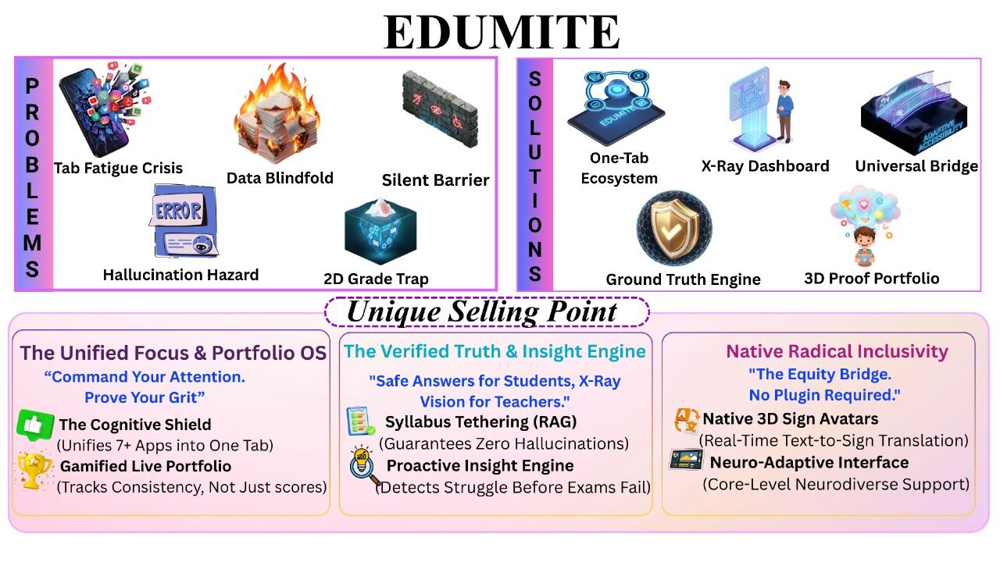
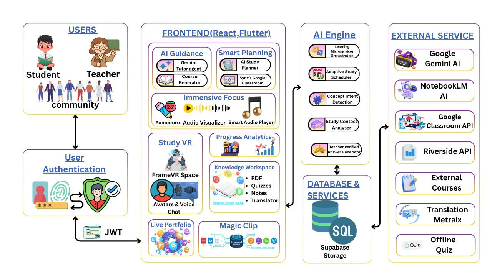
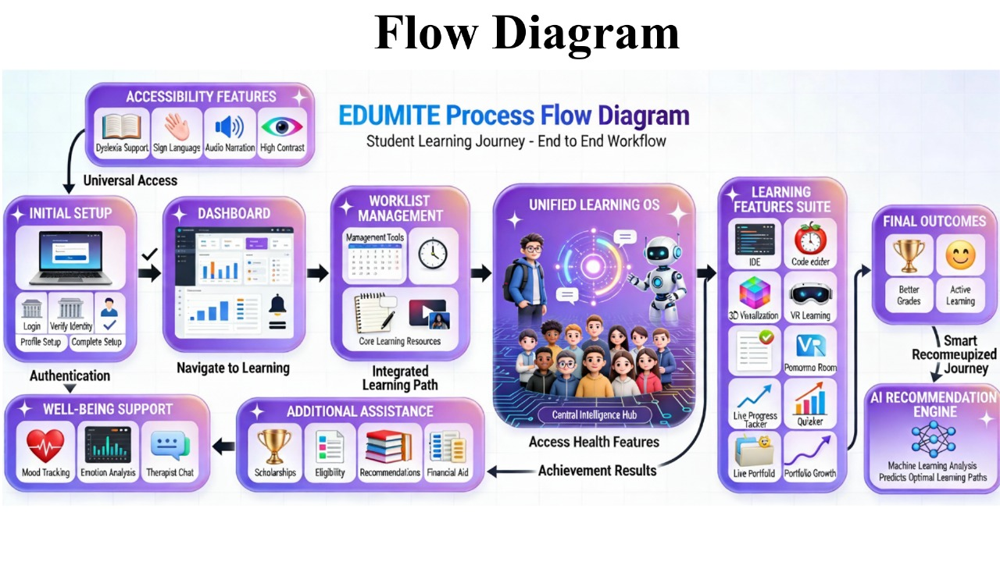

# EDUMITE - Unified Learning Operating System

[](https://reactjs.org/)
[](https://www.typescriptlang.org/)
[](https://supabase.com/)
[](https://deepmind.google/technologies/gemini/)
[](https://vitejs.dev/)
[](https://tailwindcss.com/)

> **The world's first truly unified learning platform that eliminates digital fragmentation while providing accessible, inclusive education for all learners.**

---

## 📑 Table of Contents

1. [Overview](#overview)
2. [The Problem We Solve](#the-problem-we-solve)
3. [Our Solution](#our-solution)
4. [Key Features](#key-features)
5. [Architecture](#architecture)
6. [Technology Stack](#technology-stack)
7. [Project Structure](#project-structure)
8. [Getting Started](#getting-started)
9. [Environment Configuration](#environment-configuration)
10. [Database Schema](#database-schema)
11. [Feature Deep Dive](#feature-deep-dive)
12. [Accessibility & Inclusion](#accessibility--inclusion)
13. [Security](#security)
14. [Deployment](#deployment)
15. [Contributing](#contributing)
16. [License & Support](#license--support)

---

## 🎯 Overview

**EDUMITE** is a revolutionary Unified Learning Operating System that consolidates every aspect of the educational journey into a single, cohesive workspace. Built with cutting-edge technologies and powered by Google Gemini AI, EDUMITE provides:

- ✨ **AI-Powered Learning** - Personalized tutoring, roadmap generation, and smart content adaptation
- 📚 **Unified Workspace** - All learning tools in one place with seamless navigation
- ♿ **Universal Accessibility** - Dyslexia support, colorblind modes, sign language, 30+ languages
- 🎮 **Gamified Progress** - XP, streaks, leaderboards, and achievement tracking
- 🔗 **Smart Integrations** - Google Classroom sync, calendar integration, deadline tracking
- 👥 **Collaborative Learning** - Study groups, discussion forums, mentor chat, VR study rooms

**No more juggling between Google Classroom, note-taking apps, code editors, calendar apps, focus timers, and communication tools. EDUMITE brings everything together in one intelligent, accessible, and beautifully designed platform.**

---

## 💡 The Problem We Solve

<div align="center">
  
  <p><em>Visual overview of problems we solve, our solutions, and unique selling propositions</em></p>
</div>

### Digital Fragmentation
Modern students juggle 10-15 different apps daily:
- 📱 Google Classroom for assignments
- 📝 Notes apps for studying
- 💻 IDEs for coding practice
- 📅 Calendars for deadlines
- ⏱️ Focus timers for productivity
- 💬 Chat apps for collaboration
- 📊 Analytics tools for tracking
- 🎥 Video platforms for tutorials

**Result**: Cognitive overload, missed deadlines, context switching fatigue, and scattered information.

### Accessibility Barriers
Traditional learning platforms fail students with:
- 👁️ Vision impairments (poor contrast, no dyslexia support)
- 🧠 Neurodiversity (ADHD, autism - overwhelming interfaces)
- 🌍 Language barriers (limited translation support)
- 🤟 Hearing impairments (no sign language support)
- 🎨 Color blindness (important information uses color only)

### Lack of Personalization
One-size-fits-all approaches ignore:
- Individual learning paces
- Different learning styles (visual, auditory, kinesthetic)
- Skill gaps and prerequisites
- Real-time progress adaptation
- Personalized study schedules

---

## 🚀 Our Solution

### The Unified OS Concept
EDUMITE implements a true "Operating System" for learning:

1. **Single Source of Truth**
   - All assignments, notes, schedules, and progress in one database
   - Real-time sync across all features
   - No data silos or disconnected tools

2. **Intelligent State Management**
   - Remember your last position in every course
   - Auto-save across all features
   - Persistent workspace layouts
   - Smart resume from where you left off

3. **Context-Aware Navigation**
   - Smart search across all content
   - Quick access to recent items
   - Intelligent recommendations
   - Seamless feature switching

4. **Adaptive Interface**
   - Responds to user preferences
   - Accessibility-first design
   - Multi-language support
   - Theme customization

---

## ✨ Key Features

### 🤖 AI-Powered Learning

#### **Gemini AI Tutor**
- Natural language conversations
- Context-aware explanations
- Step-by-step problem solving
- Code debugging assistance
- Multi-language support

#### **Smart Roadmap Generator**
- Personalized learning paths
- Skill gap analysis
- Time-based planning
- Adaptive difficulty
- Progress-based recommendations

#### **Content Generation**
- Auto-generate flashcards from notes
- Create quizzes from course materials
- Summarize lengthy documents
- Generate study guides
- Translate content on-demand

### 📚 Unified Workspace Features

#### **Google Classroom Integration**
- Seamless assignment sync (Pending, Upcoming, Completed)
- Course materials and files
- Due dates and deadlines
- Submission status tracking
- OAuth 2.0 secure authentication
- localStorage persistence across sessions

#### **Intelligent Course System**
- Browse curated courses
- Track progress with analytics
- Interactive code editors (Monaco)
- Video lessons with timestamps
- Practice exercises with auto-grading

#### **Advanced Note-Taking**
- Rich text editor with Markdown
- PDF uploads and annotations
- AI-powered summaries
- Flashcard generation from notes
- Tag-based organization
- Full-text search

#### **Smart Study Planner**
- AI-suggested daily schedules
- Google Classroom deadline integration
- Priority-based task sorting
- Pomodoro timer integration
- Progress tracking
- Streak and XP rewards

#### **Code Workspace**
- Monaco editor (VS Code engine)
- 50+ programming languages
- Real-time code execution (Judge0)
- Syntax highlighting
- Auto-completion
- Error detection

#### **Focus Room**
- Pomodoro timer with breaks
- Ambient sounds (rain, forest, café, ocean, space)
- Visual audio analyzer
- XP and streak tracking
- Session history
- Daily goals

#### **Study VR**
- Virtual collaboration spaces (FrameVR)
- Voice and video chat
- Avatar customization
- WASD navigation
- Screen sharing
- Whiteboard tools

### 🎮 Gamification System

#### **Experience Points (XP)**
- Earn XP for completing tasks
- Level up system
- Daily XP goals
- Bonus multipliers
- Achievement unlocks

#### **Streak Tracking**
- Daily login streaks
- Study session streaks
- Course completion streaks
- Streak recovery system
- Streak leaderboards

#### **Leaderboards**
- Global rankings
- Course-specific rankings
- Weekly/monthly competitions
- Friend comparisons
- Achievement showcases

#### **Analytics Dashboard**
- Study time tracking
- Course progress overview
- XP earnings graph
- Streak visualization
- Subject mastery charts
- Performance insights

### 📱 Smart Integrations

#### **Exam Countdown System**
- Global notification bell on all pages
- Calendar integration with visual markers
- Automatic daily midnight refresh
- Urgency-based color coding
- Real-time Supabase subscriptions
- Dashboard countdown widget
- 7-day upcoming exams banner

#### **Calendar Integration**
- Exam countdown widgets
- Deadline notifications
- Schedule visualization
- Auto-sync with Google Calendar
- Custom event creation
- Reminder system

#### **Scheme & Opportunities**
- Government scheme finder
- Scholarship alerts
- Internship postings
- Competition notifications
- Eligibility matching
- Application tracking

#### **Smart Deadlines**
- AI-powered deadline suggestions
- Conflict detection
- Priority ordering
- Reminder scheduling
- Extension requests
- Completion tracking

### ♿ Accessibility & Inclusion

#### **Visual Accessibility**
- Dyslexia-friendly font (OpenDyslexic)
- Multiple colorblind modes (Protanopia, Deuteranopia, Tritanopia)
- High contrast themes
- Adjustable font sizes
- Screen reader optimization
- Keyboard navigation

#### **Language Support**
- 30+ languages via DeepTranslate API
- Real-time translation
- Translation memory caching
- Cultural adaptation
- Right-to-left (RTL) support

#### **Sign Language**
- Indian Sign Language (ISL) support
- 850+ sign animations (CWASA library)
- Interactive lessons
- Practice mode with feedback
- Alphabet and number signs
- Common phrases library
- Text-to-sign translation

#### **Neurodiversity Support**
- Reduced motion options
- Simplified interfaces
- Focus mode (distraction-free)
- Consistent navigation patterns
- Clear visual hierarchy
- Predictable interactions

### 👥 Community Features

#### **Discussion Forums**
- Course-specific discussions
- Topic-based threads
- Voting system
- Best answer marking
- Rich text formatting
- File attachments

#### **Study Groups**
- Create and join groups
- Group chat (real-time)
- Shared resources
- Collaborative notes
- Group challenges
- Member management

#### **Mentor Chat**
- AI-powered mentor assistant
- Human mentor connection
- Question-answer format
- Resource recommendations
- Progress reviews
- Career guidance

### 🎯 Mathematics Hub
- Interactive problem solver
- Step-by-step solutions
- Formula library
- Graph plotter
- Practice problems by topic
- Video explanations
- LaTeX equation editor
- VR Mathematics Classroom with collaborative tools

### 🎮 Gaming & Competition
- Educational mini-games
- Multiplayer competitions
- Skill-based matchmaking
- Real-time leaderboards
- Reward systems
- Tournament hosting

---

## 🏗️ Architecture

<div align="center">
  
  <p><em>Complete technical architecture showing frontend, backend, and external service integrations</em></p>
</div>

### System Architecture

```
┌─────────────────────────────────────────────────────────────────┐
│                        EDUMITE Frontend                         │
│                     (React 18 + TypeScript)                     │
├─────────────────────────────────────────────────────────────────┤
│                                                                 │
│  ┌──────────────┐  ┌──────────────┐  ┌──────────────┐        │
│  │   UI Layer   │  │  State Mgmt  │  │   Routing    │        │
│  │   (shadcn)   │  │  (Zustand)   │  │(React Router)│        │
│  └──────────────┘  └──────────────┘  └──────────────┘        │
│                                                                 │
│  ┌──────────────────────────────────────────────────────────┐ │
│  │              Service Layer (Business Logic)              │ │
│  ├──────────────────────────────────────────────────────────┤ │
│  │ Auth │ Courses │ Classroom │ Notes │ Analytics │ AI      │ │
│  └──────────────────────────────────────────────────────────┘ │
│                                                                 │
│  ┌──────────────────────────────────────────────────────────┐ │
│  │                  API Integration Layer                    │ │
│  ├──────────────────────────────────────────────────────────┤ │
│  │  Supabase  │  Gemini AI  │  Google APIs  │  RapidAPI   │ │
│  └──────────────────────────────────────────────────────────┘ │
└─────────────────────────────────────────────────────────────────┘
                               │
                               ▼
┌─────────────────────────────────────────────────────────────────┐
│                    External Services                            │
├─────────────────────────────────────────────────────────────────┤
│                                                                 │
│  ┌──────────────┐  ┌──────────────┐  ┌──────────────┐        │
│  │  Supabase    │  │  Google      │  │  RapidAPI    │        │
│  │  (Database,  │  │  (Gemini AI, │  │  (Judge0,    │        │
│  │   Auth,      │  │   Classroom, │  │   DeepTrans) │        │
│  │   Storage)   │  │   OAuth)     │  │              │        │
│  └──────────────┘  └──────────────┘  └──────────────┘        │
└─────────────────────────────────────────────────────────────────┘
```

### Application Flow & Workflow

<div align="center">
  
  <p><em>User journey and workflow through the EDUMITE platform</em></p>
</div>

### Data Flow

```
User Action → Component → Service → API → Database/External API
                ↓                            ↓
            State Update ←─────────────── Response
                ↓
           UI Re-render
```

---

## 🛠️ Technology Stack

### Frontend Core
| Technology | Version | Purpose |
|------------|---------|---------|
| React | 18.3.1 | UI framework |
| TypeScript | 5.6.2 | Type safety |
| Vite | 7.0.2 | Build tool & dev server |
| React Router | 6.30.1 | Client-side routing |

### State Management
| Technology | Purpose |
|------------|---------|
| Zustand | Global state (user, theme, navigation) |
| React Query | Server state caching & sync |
| React Hook Form | Form state management |
| Zod | Schema validation |

### UI Components & Styling
| Technology | Purpose |
|------------|---------|
| Tailwind CSS | Utility-first styling |
| shadcn/ui | Component library (Radix UI) |
| Framer Motion | Animations & transitions |
| Lucide React | Icon library |
| Recharts | Data visualization |

### Backend Services
| Service | Purpose |
|---------|---------|
| Supabase | PostgreSQL database, Auth, Storage |
| Express.js | API proxy server (port 3001) |

### AI & Integrations
| Service | Purpose |
|---------|---------|
| Google Gemini Pro | AI tutor, content generation |
| Google Classroom API | Assignment & material sync |
| Google OAuth 2.0 | Secure authentication |
| RapidAPI Judge0 | Code execution sandbox |
| RapidAPI DeepTranslate | Multi-language translation |

### 3D Graphics
| Technology | Purpose |
|------------|---------|
| Three.js | WebGL 3D rendering |
| React Three Fiber | React renderer for Three.js |
| React Three Drei | Three.js helpers |
| CWASA Library | 3D sign language avatars |

### Development Tools
| Tool | Purpose |
|------|---------|
| ESLint | Code linting |
| Prettier | Code formatting |
| Concurrently | Run multiple dev servers |

---

## 📁 Project Structure

```
SYLEDUTECH/
├── public/                          # Static assets
│   ├── audio/                       # Ambient sounds for Focus Room
│   ├── SignFiles/                   # Sign language animations (.sigml)
│   └── robots.txt
│
├── server/
│   └── index.js                     # Express API proxy
│
├── src/
│   ├── components/                  # React components
│   │   ├── ui/                      # shadcn/ui primitives
│   │   ├── 3D/                      # Three.js components
│   │   ├── signLanguage/            # Sign language components
│   │   ├── ClassroomAssignmentsPanel.tsx
│   │   ├── DiscussionForum.tsx
│   │   ├── ExamCountdownWidget.tsx
│   │   ├── ExamNotificationBell.tsx
│   │   ├── IDE.tsx
│   │   ├── MentorChat.tsx
│   │   ├── Navbar.tsx
│   │   ├── StudyGroupChat.tsx
│   │   ├── ThemeProvider.tsx
│   │   ├── TranslatedText.tsx
│   │   └── TranslationProvider.tsx
│   │
│   ├── config/                      # Configuration files
│   │   └── sign-language-content.ts
│   │
│   ├── hooks/                       # Custom React hooks
│   │   ├── useGoogleClassroom.ts   # Google Classroom integration
│   │   ├── useExamCountdown.ts     # Exam countdown logic
│   │   ├── useToast.ts
│   │   ├── useTranslation.ts
│   │   ├── useSoundPlayer.ts
│   │   └── use-mobile.tsx
│   │
│   ├── lib/                         # Core utilities
│   │   ├── auth.ts                  # Auth helpers
│   │   ├── gemini.ts                # Gemini AI client
│   │   ├── supabase.ts              # Supabase client
│   │   └── utils.ts                 # General utilities
│   │
│   ├── pages/                       # Page components (40+)
│   │   ├── AdaptiveContent.tsx
│   │   ├── AIBot.tsx                # AI Tutor chat
│   │   ├── Analytics.tsx            # Progress dashboard
│   │   ├── Community.tsx            # Forums & groups
│   │   ├── CourseDetail.tsx
│   │   ├── Courses.tsx
│   │   ├── CreateSpace.tsx
│   │   ├── DashboardGold.tsx        # Main dashboard
│   │   ├── FocusRoom.tsx            # Pomodoro timer
│   │   ├── GameHub.tsx              # Educational games
│   │   ├── KnowledgeOrbit/          # 3D course visualization
│   │   ├── LandingGold.tsx          # Landing page
│   │   ├── Login.tsx
│   │   ├── MathematicsHub.tsx       # Math problem solver
│   │   ├── Notes.tsx                # Note-taking
│   │   ├── NotFound.tsx
│   │   ├── Onboarding.tsx           # First-time setup
│   │   ├── Register.tsx
│   │   ├── Roadmap.tsx              # Learning paths
│   │   ├── Schemes.tsx              # Scholarships
│   │   ├── Settings.tsx
│   │   ├── SignLanguage*.tsx        # Sign language features
│   │   ├── SmartDeadline.tsx
│   │   ├── SmartOpportunities.tsx
│   │   ├── StudyPlanner.tsx         # AI schedule planner
│   │   ├── StudyVR.tsx              # Virtual study room
│   │   ├── UnifiedOS.tsx            # Main workspace
│   │   ├── Wellness.tsx
│   │   ├── Workspace*.tsx           # Code editor
│   │   └── game/                    # Game components
│   │
│   ├── services/                    # API service layer
│   │   ├── analyticsService.ts
│   │   ├── authService.ts
│   │   ├── classroomService.ts      # Google Classroom API
│   │   ├── communityService.ts
│   │   ├── courseGeneratorService.ts
│   │   ├── courseService.ts
│   │   ├── examNotificationService.ts
│   │   ├── leaderboardService.ts
│   │   ├── notesService.ts
│   │   ├── roadmapService.ts
│   │   ├── translateService.ts
│   │   └── userService.ts
│   │
│   ├── store/                       # Zustand stores
│   │   ├── themeStore.ts            # Theme, accessibility, language
│   │   └── userStore.ts             # Auth & user data
│   │
│   ├── types/                       # TypeScript types
│   │   ├── classroom.ts
│   │   └── examNotifications.ts
│   │
│   ├── utils/                       # Utility functions
│   │   └── generateSchedule.js
│   │
│   ├── App.tsx                      # Root component
│   ├── main.tsx                     # Entry point
│   └── index.css                    # Global styles
│
├── supabase/                        # Database migrations
│   └── migrations/
│       └── 001_exam_notifications.sql
│
├── .env.example                     # Environment template
├── .gitignore
├── components.json                  # shadcn/ui config
├── eslint.config.js
├── index.html
├── package.json
├── postcss.config.js
├── tailwind.config.ts
├── tsconfig.json
├── vite.config.ts
└── README.md                        # This file
```

---

## 🚀 Getting Started

### Prerequisites

Before you begin, ensure you have:

- ✅ **Node.js** 18+ and npm installed
- ✅ **Git** for version control
- ✅ **Supabase Account** (free tier available)
- ✅ **Google Cloud Console** project with Classroom API enabled
- ✅ **Google Gemini API Key** from AI Studio
- ✅ **RapidAPI Account** (optional, for Judge0 and DeepTranslate)

### Installation Steps

#### 1. Clone the Repository

```bash
git clone https://github.com/SYLESH-1125/SYLEDUTECH.git
cd SYLEDUTECH
```

#### 2. Install Dependencies

```bash
npm install
```

#### 3. Set Up Supabase

1. Create a new project at [supabase.com](https://supabase.com)
2. Navigate to SQL Editor
3. Run the database schema (see [Database Schema](#database-schema) section)
4. Get your credentials:
   - Project URL: Settings → API → Project URL
   - Anon Key: Settings → API → Project API keys → anon/public

#### 4. Configure Google Cloud Console

1. Go to [Google Cloud Console](https://console.cloud.google.com/)
2. Create a new project or select existing
3. Enable the **Google Classroom API**
4. Create OAuth 2.0 credentials:
   - Application type: **Web application**
   - Authorized JavaScript origins: `http://localhost:8080`
   - Authorized redirect URIs: `http://localhost:8080`
5. Add required scopes:
   ```
   https://www.googleapis.com/auth/classroom.courses.readonly
   https://www.googleapis.com/auth/classroom.coursework.me
   https://www.googleapis.com/auth/classroom.coursework.me.readonly
   https://www.googleapis.com/auth/classroom.courseworkmaterials.readonly
   https://www.googleapis.com/auth/userinfo.email
   https://www.googleapis.com/auth/userinfo.profile
   ```
6. Save your **Client ID**

#### 5. Get API Keys

- **Gemini API**: Get from [Google AI Studio](https://makersuite.google.com/app/apikey)
- **RapidAPI** (optional):
  - Sign up at [RapidAPI Hub](https://rapidapi.com/hub)
  - Subscribe to Judge0 and Deep Translate API

#### 6. Create Environment File

Create a `.env` file in the root directory:

```bash
# Supabase Configuration
VITE_SUPABASE_URL=your-supabase-project-url
VITE_SUPABASE_ANON_KEY=your-supabase-anon-key

# Google Gemini AI
VITE_GEMINI_API_KEY=your-gemini-api-key

# Google Classroom OAuth
VITE_GOOGLE_CLIENT_ID=your-client-id.apps.googleusercontent.com

# RapidAPI (Optional)
VITE_RAPIDAPI_KEY=your-rapidapi-key

# Backend API
VITE_API_URL=http://localhost:3001
```

#### 7. Run the Development Server

```bash
# Run both frontend and backend
npm run dev:all

# Or run separately:
npm run dev          # Frontend only (port 8080)
npm run dev:server   # Backend only (port 3001)
```

#### 8. Open the Application

Navigate to `http://localhost:8080` in your browser.

---

## ⚙️ Environment Configuration

### Complete Environment Variables

```bash
# ==========================================
# CORE SERVICES
# ==========================================

# Supabase (Required)
VITE_SUPABASE_URL=https://your-project.supabase.co
VITE_SUPABASE_ANON_KEY=your-anon-key

# Google Gemini AI (Required)
VITE_GEMINI_API_KEY=AIzaSy...your-key

# ==========================================
# GOOGLE INTEGRATIONS
# ==========================================

# Google Classroom (Required for assignment sync)
VITE_GOOGLE_CLIENT_ID=xxxxx-xxxxx.apps.googleusercontent.com

# ==========================================
# RAPIDAPI SERVICES (Optional)
# ==========================================

# RapidAPI Key (for Judge0 and DeepTranslate)
VITE_RAPIDAPI_KEY=your-rapidapi-key

# Judge0 Code Execution
VITE_JUDGE0_URL=https://judge0-ce.p.rapidapi.com
VITE_JUDGE0_HOST=judge0-ce.p.rapidapi.com

# ==========================================
# BACKEND API
# ==========================================

# Express server
VITE_API_URL=http://localhost:3001
```

---

## 🗄️ Database Schema

### Core Tables

#### **users**
Extended user profiles linked to Supabase Auth
```sql
CREATE TABLE users (
  id UUID PRIMARY KEY REFERENCES auth.users,
  email TEXT UNIQUE,
  name TEXT,
  xp INTEGER DEFAULT 0,
  level INTEGER DEFAULT 1,
  streak INTEGER DEFAULT 0,
  last_login TIMESTAMP,
  preferences JSONB,
  created_at TIMESTAMP DEFAULT NOW(),
  updated_at TIMESTAMP DEFAULT NOW()
);

-- Enable RLS
ALTER TABLE users ENABLE ROW LEVEL SECURITY;

-- Policy: Users can view their own profile
CREATE POLICY "Users can view own profile" ON users
  FOR SELECT USING (auth.uid() = id);

-- Policy: Users can update their own profile
CREATE POLICY "Users can update own profile" ON users
  FOR UPDATE USING (auth.uid() = id);
```

#### **courses**
Course catalog and metadata
```sql
CREATE TABLE courses (
  id UUID PRIMARY KEY DEFAULT uuid_generate_v4(),
  title TEXT NOT NULL,
  description TEXT,
  level TEXT CHECK (level IN ('beginner', 'intermediate', 'advanced')),
  category TEXT,
  duration INTEGER, -- minutes
  published BOOLEAN DEFAULT false,
  thumbnail_url TEXT,
  content JSONB, -- Multi-language support
  created_by UUID REFERENCES users(id),
  created_at TIMESTAMP DEFAULT NOW()
);

-- Enable RLS
ALTER TABLE courses ENABLE ROW LEVEL SECURITY;

-- Policy: Courses are public read
CREATE POLICY "Courses public read" ON courses
  FOR SELECT USING (true);

-- Policy: Authenticated users can insert
CREATE POLICY "Courses authenticated insert" ON courses
  FOR INSERT WITH CHECK (auth.uid() IS NOT NULL);
```

#### **exam_schedules**
Exam countdown notification system
```sql
CREATE TABLE exam_schedules (
  id UUID PRIMARY KEY DEFAULT uuid_generate_v4(),
  user_id UUID REFERENCES users(id) ON DELETE CASCADE,
  exam_name TEXT NOT NULL,
  subject TEXT,
  exam_date DATE NOT NULL,
  exam_time TIME,
  location TEXT,
  notes TEXT,
  color TEXT DEFAULT '#C9B458',
  created_at TIMESTAMP DEFAULT NOW(),
  updated_at TIMESTAMP DEFAULT NOW()
);

-- Enable RLS
ALTER TABLE exam_schedules ENABLE ROW LEVEL SECURITY;

-- Policy: Users can view their own exams
CREATE POLICY "Users can view own exams" ON exam_schedules
  FOR SELECT USING (auth.uid() = user_id);

-- Policy: Users can insert their own exams
CREATE POLICY "Users can insert own exams" ON exam_schedules
  FOR INSERT WITH CHECK (auth.uid() = user_id);

-- Policy: Users can update their own exams
CREATE POLICY "Users can update own exams" ON exam_schedules
  FOR UPDATE USING (auth.uid() = user_id);

-- Policy: Users can delete their own exams
CREATE POLICY "Users can delete own exams" ON exam_schedules
  FOR DELETE USING (auth.uid() = user_id);
```

### Storage Buckets

- **notes-attachments**: User-uploaded files for notes
- **course-materials**: Course content files
- **user-avatars**: Profile pictures

All buckets use RLS for secure access control.

---

## 🎓 Feature Deep Dive

### 1. Google Classroom Integration

**Purpose**: Eliminate the need to switch between EDUMITE and Google Classroom.

**Features**:
- ✅ OAuth 2.0 secure authentication
- ✅ Real-time assignment sync
- ✅ Three-column Kanban: Pending | Upcoming | Completed
- ✅ Material and file access
- ✅ Due date tracking
- ✅ Status updates
- ✅ localStorage persistence across sessions

**Implementation**:
```typescript
// src/hooks/useGoogleClassroom.ts
const {
  assignments,       // Categorized assignments
  courses,          // All synced courses
  materials,        // Course materials
  isConnected,      // Connection status
  connectAndSync,   // OAuth + sync function
  refreshAssignments, // Manual refresh
  disconnect        // Clear connection
} = useGoogleClassroom();
```


### 2. Exam Countdown System

**Purpose**: Never miss an exam deadline with persistent notifications.

**Features**:
- Global notification bell on all pages
- Badge counter showing upcoming exams
- Urgency-based color coding (Red/Orange/Yellow/Gold)
- Calendar integration with visual markers
- Dashboard countdown widget
- 7-day upcoming exams banner
- Automatic midnight refresh
- Real-time Supabase subscriptions


### 3. AI Tutor (Gemini)

**Purpose**: Provide 24/7 personalized learning assistance.

**Capabilities**:
- Natural language Q&A
- Step-by-step explanations
- Code debugging
- Concept clarification
- Practice problem generation
- Multi-language support

### 4. Smart Study Planner

**Purpose**: AI-powered daily schedule generation.

**Features**:
- Imports Google Classroom deadlines
- Prioritizes by due date
- Suggests study sessions
- Integrates with Focus Room
- Tracks completion
- Adaptive rescheduling

### 5. Focus Room

**Purpose**: Immersive productivity environment with Pomodoro technique.

**Features**:
- Customizable work/break intervals
- 6 ambient soundscapes
- Real-time audio visualizer
- XP rewards per session
- Streak tracking
- Session history

### 6. Code Workspace

**Purpose**: Learn programming without leaving EDUMITE.

**Features**:
- Monaco editor (VS Code engine)
- 50+ language support
- Real-time execution via Judge0
- Syntax highlighting
- Auto-completion
- Output console

### 7. Sign Language Learning

**Purpose**: Make education accessible to deaf and hard-of-hearing students.

**Features**:
- 850+ ISL signs (CWASA library)
- 3D avatar animations
- Text-to-sign translator
- Interactive lessons
- Practice mode with feedback

### 8. Study VR

**Purpose**: Virtual collaboration for remote study groups.

**Features**:
- FrameVR 3D meeting spaces
- Voice and video chat
- Screen sharing
- Whiteboard tools
- Mathematics VR Classroom with collaborative tools

### 9. Analytics Dashboard

**Purpose**: Visualize learning progress.

**Metrics**:
- Total XP earned
- Study time tracking
- Course completion
- Quiz scores
- Streak history
- Subject mastery

### 10. Mathematics Hub

**Purpose**: Interactive math problem-solving.

**Features**:
- AI-powered solver (Gemini)
- Step-by-step explanations
- Graph plotting
- Formula library
- Practice problems
- VR classroom integration

---

## ♿ Accessibility & Inclusion

### Vision Accessibility

#### **Dyslexia Support**
- OpenDyslexic font
- Increased spacing
- Bottom-heavy letter shapes
- Unique character forms

#### **Colorblind Modes**
- Protanopia (Red-blind)
- Deuteranopia (Green-blind)
- Tritanopia (Blue-blind)

#### **High Contrast Theme**
- Black/white stark contrast
- Thick borders
- Bold text weights
- Clear focus indicators

#### **Font Size Control**
- Small (14px)
- Medium (16px)
- Large (18px)
- Extra Large (20px)

### Language Support

**30+ Languages via DeepTranslate API**:
- English, Spanish, French, German, Chinese, Japanese, Korean, Hindi, Arabic, Portuguese, Russian, Italian, and more

**Features**:
- Real-time translation
- Context-aware translations
- Translation caching
- RTL support

### Sign Language Support

**Indian Sign Language (ISL)**:
- 850+ sign animations
- Alphabet signs (A-Z)
- Number signs (0-100)
- Common phrases
- Educational terms
- Interactive lessons

**File Format**: SIGML (Sign Language Markup Language)

### Neurodiversity Support

**ADHD/Autism-Friendly Design**:
- Reduced motion option
- Simplified interface mode
- Focus mode
- Consistent layouts
- Clear visual hierarchy

### Keyboard Navigation

- Full keyboard support
- Tab navigation
- Arrow keys for lists
- Enter/Space activation
- Escape to close dialogs

---

## 🔒 Security

### Authentication & Authorization

**Supabase Auth**:
- Email/password authentication
- OAuth providers (Google, GitHub)
- JWT token-based sessions
- Automatic token refresh
- Secure password hashing

**Row Level Security (RLS)**:
```sql
-- Users can only access their own data
CREATE POLICY "Users can view own notes"
ON notes FOR SELECT
USING (auth.uid() = user_id);
```

### Data Protection

**Environment Variables**:
- All API keys in `.env` (not committed)
- Different configs for dev/prod
- No hardcoded secrets

**API Security**:
- CORS configuration
- Rate limiting
- Input validation (Zod)
- SQL injection prevention
- XSS protection

### Best Practices

1. Never commit `.env` files
2. Use HTTPS in production
3. Validate all user inputs
4. Implement rate limiting
5. Regular dependency updates
6. Monitor for vulnerabilities

---

## 🚢 Deployment

### Frontend Deployment (Vercel - Recommended)

1. Connect GitHub repository
2. Configure build settings:
   ```bash
   Build Command: npm run build
   Output Directory: dist
   ```
3. Add environment variables in Vercel dashboard
4. Deploy automatically on git push

### Backend Deployment (Railway)

1. Create new project from GitHub
2. Add service for `server/index.js`
3. Configure environment variables
4. Deploy automatically

### Database (Supabase)

**No deployment needed** - Supabase is hosted.

**Production Checklist**:
- [ ] Enable RLS on all tables
- [ ] Set up database backups
- [ ] Configure connection pooling
- [ ] Monitor database performance

---

## 🤝 Contributing

We welcome contributions! Here's how to get started:

### Development Workflow

1. Fork the repository
2. Clone your fork
3. Create a feature branch: `git checkout -b feature/amazing-feature`
4. Make your changes
5. Test thoroughly
6. Commit: `git commit -m "feat: add amazing feature"`
7. Push: `git push origin feature/amazing-feature`
8. Open a Pull Request

### Commit Message Convention

Follow [Conventional Commits](https://www.conventionalcommits.org/):

```
feat: add new feature
fix: bug fix
docs: documentation changes
style: formatting changes
refactor: code refactoring
test: add tests
chore: maintenance tasks
```

---

## 📄 License & Support

### License

This project is licensed under the **MIT License**.

```
MIT License

Copyright (c) 2025 SYLESH-1125

Permission is hereby granted, free of charge, to any person obtaining a copy
of this software and associated documentation files (the "Software"), to deal
in the Software without restriction, including without limitation the rights
to use, copy, modify, merge, publish, distribute, sublicense, and/or sell
copies of the Software, and to permit persons to whom the Software is
furnished to do so, subject to the following conditions:

The above copyright notice and this permission notice shall be included in all
copies or substantial portions of the Software.

THE SOFTWARE IS PROVIDED "AS IS", WITHOUT WARRANTY OF ANY KIND, EXPRESS OR
IMPLIED, INCLUDING BUT NOT LIMITED TO THE WARRANTIES OF MERCHANTABILITY,
FITNESS FOR A PARTICULAR PURPOSE AND NONINFRINGEMENT. IN NO EVENT SHALL THE
AUTHORS OR COPYRIGHT HOLDERS BE LIABLE FOR ANY CLAIM, DAMAGES OR OTHER
LIABILITY, WHETHER IN AN ACTION OF CONTRACT, TORT OR OTHERWISE, ARISING FROM,
OUT OF OR IN CONNECTION WITH THE SOFTWARE OR THE USE OR OTHER DEALINGS IN THE
SOFTWARE.
```

### Support & Contact

**Issues & Bugs**:
- GitHub Issues: [Report a bug](https://github.com/SYLESH-1125/SYLEDUTECH/issues)

**Documentation**:
- Full documentation available in README.md

---

## 🙏 Acknowledgments

### Technologies & Services

- **React Team** - For the amazing UI framework
- **Vercel** - For Vite and hosting solutions
- **Supabase** - For the incredible backend-as-a-service
- **Google** - For Gemini AI and Classroom API
- **shadcn** - For the beautiful UI component library
- **Radix UI** - For accessible component primitives
- **Judge0** - For code execution infrastructure
- **FrameVR** - For virtual reality spaces
- **University of East Anglia** - For CWASA sign language library

---

<div align="center">

### Built with ❤️ for learners everywhere

**Made by students, for students**

[⭐ Star us on GitHub](https://github.com/SYLESH-1125/SYLEDUTECH) | [🐛 Report Bug](https://github.com/SYLESH-1125/SYLEDUTECH/issues) | [💡 Request Feature](https://github.com/SYLESH-1125/SYLEDUTECH/discussions)

---

## 🎓 Educational Philosophy

**EDUMITE believes**:
- Education should be accessible to everyone
- Technology should enhance learning, not complicate it
- Fragmented tools create fragmented experiences
- AI can personalize education at scale
- Every learner deserves tools that adapt to their needs

---


**© 2025 SYLESH PAVENDAN** | All Rights Reserved

</div>
